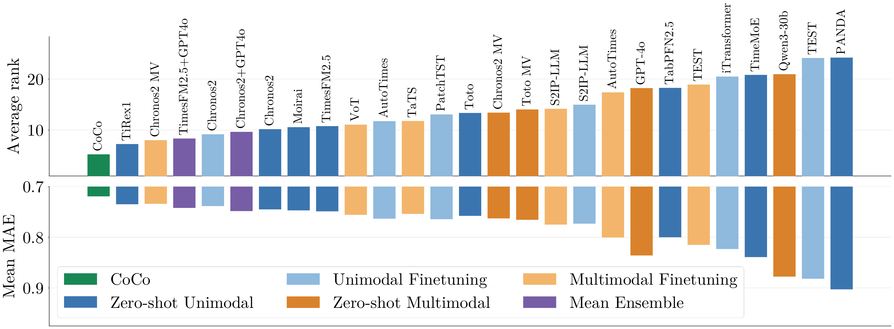

<h1 align="center">CoCo</h1>

<h2 align="center">TSFM Meets LLM: <ins>Co</ins>ntext as <ins>Co</ins>variate (NeurIPS'26)</h2>

<p align="center">
  <a href="#release-links">📄 Paper (coming soon)</a> &nbsp;|&nbsp;
  <a href="https://github.com/UTAustin-SwarmLab/CoCo"> GitHub</a> &nbsp;|&nbsp;
  <a href="https://huggingface.co/collections/SWARM-Lab/coco-6ac8255ad044393eed8316c0">🤗 Hugging Face</a>
</p>

CoCo combines historical numerical values and textual context to forecast time
series. A fine-tuned **Qwen3-4B** generates forecast and confidence covariates,
which are supplied to a fine-tuned **Chronos2** to produce the final forecast.
Both fine-tuned components are distributed as lightweight LoRA adapters.

This repository provides standalone inference with **Transformers + PEFT** or
**vLLM**. The default pipeline uses five LLM rollouts and both covariates; an
optional greedy mode uses the forecast covariate alone. No inference server,
research repository, or evaluation dataset is required.


**Context as Covariates.** The LLM turns numerical history and text into forecast and confidence covariates, which Chronos2 combines with the history to produce the final forecast.

## Installation

From the repository directory, install the locked dependencies with `uv` and
authenticate with Hugging Face:

```bash
uv sync
uv run hf auth login
```

The two `SWARM-Lab` adapter repositories currently require authorized access.
Base models and adapters are fetched through Hugging Face and cached outside
the Git repository. No weights or evaluation datasets are bundled.

## Quick start

Run a self-contained example with synthetic inputs:

```bash
uv run python examples/forecast.py --device cuda:0
```

Or forecast directly from Python (five rollouts with both covariates by default):

```python
from coco_ts import CoCo

model = CoCo.from_pretrained(device="cuda:0")
result = model.predict(
    history=[100.0, 101.0, 100.5, 102.0],
    text=[None, "Demand increased.", None, "Orders remain strong."],
    prediction_length=16,
    seed=42,
)
print(result.values)  # original units
```

Supply historical values and aligned historical text only. Optional `timestamps`
and `forecast_timestamps` describe dates, never future observed values or text.
The LLM sees the last 64 history points and last 16 annotations, matching the
current evaluator; Chronos2 receives the entire supplied history.

## Inference with vLLM

```bash
uv sync --extra vllm
CUDA_VISIBLE_DEVICES=0 uv run --extra vllm python examples/forecast.py --backend vllm
```

The optional extra pins vLLM 0.11.2 and both FlashInfer packages to 0.5.2.
Use this project's environment; do not reuse an unrelated vLLM installation.
Keep `--extra vllm` on `uv run` commands so uv retains the optional dependencies.
For a shared GPU, reduce the memory allocation explicitly:

```python
from coco_ts import CoCo

def main():
    with CoCo.from_pretrained(
        backend="vllm", device="cuda:0",
        vllm_options={"gpu_memory_utilization": 0.3},
    ) as model:
        result = model.predict([100., 101., 100.5, 102.], [None] * 4)
        print(result.values)

if __name__ == "__main__":
    main()
```

vLLM batches the five rollout requests with separate seeds, using no prefix
caching or chunked prefill. Seeds are best-effort: exact repeated sampled
outputs are not guaranteed by this backend, even in the same environment.
Transformers repeated exactly in our tested setup, but reproducibility across
hardware and library versions is not guaranteed. Select physical GPUs
using `CUDA_VISIBLE_DEVICES`; keep `device="cuda:0"` inside the process. Use a
main guard in scripts because vLLM starts a worker process. The default memory
fraction is 0.7; leave space for Chronos2 and other users' jobs. Call `close()`
when finished, or use the context manager shown above. Linux with an NVIDIA GPU
is required for the pinned vLLM backend; Transformers does not require vLLM.

## Forecasting modes

The default is **five sampled LLM rollouts** at temperature 1.0, with **both**
the median forecast covariate and rollout-variance confidence covariate:

```python
result = model.predict(history, text, seed=42)
# Equivalent: mode="rollouts", n_rollouts=5, temperature=1.0
```

Optional greedy decoding uses one forecast and **omits the confidence column
entirely**, rather than supplying zeros. This is a forecast-only ablation:

```python
result = model.predict(history, text, mode="greedy", seed=42)
assert result.llm_variance is None
```

Greedy mode overrides rollout count and temperature to 1 and 0. Rollout mode
requires at least two samples and a positive temperature. `result.rollouts`
contains all parsed forecasts in original units, for inspection.

## Model checkpoints

- **LLM adapter:** `SWARM-Lab/CoCo-Qwen3-4B-LoRA`, for `Qwen/Qwen3-4B-Instruct-2507`.
- **Chronos2 adapter:** `SWARM-Lab/CoCo-Chronos2-LoRA`, for `amazon/chronos-2`.

Both adapters are currently private. `CoCo.from_pretrained()` loads them using
your Hugging Face credentials. It also accepts local paths or Hub IDs through
`llm_base`, `chronos_base`, `llm_adapter`, and `chronos_adapter`; optional revision
arguments allow pinning all four components. Chronos2's adapter is merged in
memory; Qwen's adapter is loaded by PEFT or vLLM. Models load once per instance.

## Benchmarks



**CoCo achieves the best average rank and mean MAE against 27 baselines across 30 datasets (95 settings).** Lower is better for both metrics.

## Release links

The paper URL will be added when confirmed.
The Hugging Face link above points to the CoCo collection; model access remains
restricted during private staging.
